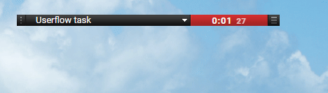
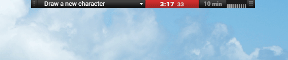
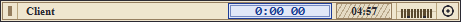
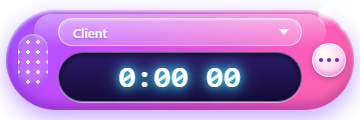

# Chronobar

**Client Time Tracker.** A thin always-on-top strip that counts your working time per client. Pick a client, press the timer, work. That's it.

**Chronobar Free:**

**Chronobar Pro:**

> **Beta:** all Pro gadgets are unlocked until **November 1, 2026, 00:00 UTC**. After that date the app runs as the Free edition. Pro will return as a paid upgrade.

## Features

- **Thin strip** (400x16 px by default) that stays on top of other windows and snaps to screen edges.
- **Separate time for every client.** Choose a client from the drop-down and start the counter.
- **Gadgets** (Pro): countdown timer, RAM indicator (numbers or graph), more coming.
- **Skins.** Change the look with plain HTML and CSS. See the [Skin Guide](docs/SKIN_GUIDE.md).
- **Tray icon.** Close the window and it keeps running in the tray.
- **Portable.** No installer. Your data lives next to the exe.
- **Private.** No network access, no telemetry, no accounts.

## Free and Pro

| | Free | Pro |
|---|---|---|
| Client time counter | Yes | Yes |
| Clients | up to 3 | up to 500 |
| Countdown timer (5/10/15/20/30 min) | - | Yes |
| RAM indicator (numbers / graph) | - | Yes |
| Custom skins | - (Default skin only) | Yes |
| Scale 150% / 200% | - | Yes |
| Future gadgets | - | Yes |

## Download and run

1. Open the [Releases](../../releases) page and download the latest `Chronobar Portable` archive.
2. Unzip it to any folder where you have write access (not `Program Files`).
3. Run the exe.

**Windows SmartScreen.** The exe is not code-signed yet, so Windows may show "Windows protected your PC". Click **More info**, then **Run anyway**. You can also scan the file on VirusTotal first.

**Requirements:** Windows 10/11 with WebView2 (preinstalled on current Windows versions).

## Your data

- `clients.json` (next to the exe): client names and tracked time. Plain JSON, easy to back up.
- `settings.json` (app config folder): skin, window position, scale and gadget options.

Nothing is ever sent anywhere.

## Skins

A skin is a folder (or a zip) with `skin.json`, `skin.html` and `skin.css`. Put it into the `Skins` folder next to the exe and pick it from the menu. Full instructions: [docs/SKIN_GUIDE.md](docs/SKIN_GUIDE.md).

Skin examples:

## Feedback and support

- Open an [issue](../../issues) here.
- Or reply in the Reddit thread where you found the app.

Tell me which gadgets you would like to see next.

## License

Chronobar is free to use, but it is not open source. See [LICENSE.md](LICENSE.md).
